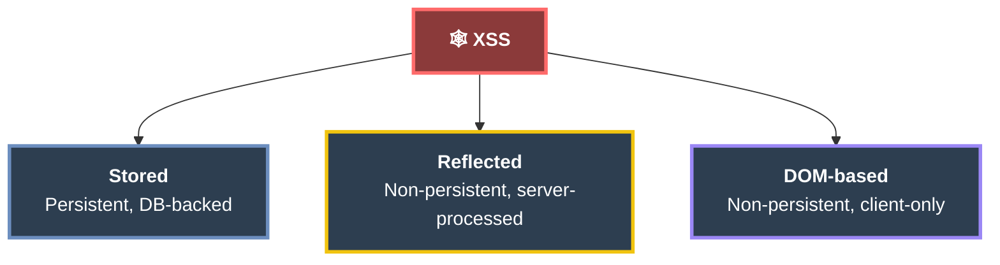

# 🕸️ Cross-Site Scripting (XSS)  
*Delve into the shadowy realms where malicious scripts weave their spells to ensnare the unsuspecting browser — mastering the art to detect and wield XSS vulnerabilities.*

> *“In the web’s dark weave, a single script can summon chaos and command unseen forces.”*

---

### 🔷 Chapter 1: What is XSS
### 🟠 Chapter 2: Types of XSS
### 🟢 Chapter 3: Stored XSS
- XSS Testing Payloads
### 🔵 Chapter 4: Reflected XSS
### 🟣 Chapter 5: DOM XSS
- Source & Sink
- DOM Attacks
### 🔍 Chapter 6: XSS Discovery
- Automated Discovery
- Manual Discovery

---

<details>
<summary><h2>🔷 What is XSS</h2></summary>

A web application receives HTML code from the back-end server and renders it on the client-side browser. When the application does **not properly sanitize user input**, an attacker can inject extra JavaScript code into an input field (e.g., comment/reply). Once another user views that page, their browser unknowingly executes the malicious JavaScript.

XSS vulnerabilities execute **solely on the client-side** and do not directly affect the back-end server — they only affect the user viewing the page. This gives XSS a relatively **low impact**, but it is found in a very **high proportion** of web applications.

XSS attacks can execute **anything achievable through browser JavaScript**, including:

- Stealing the target's **session cookie** and sending it to an attacker-controlled server.
- Forcing the browser to make **API calls** that perform a malicious action (e.g., changing the user's password).
- Other payloads ranging from crypto-mining scripts to displaying ads.

**Limitations:**

- Execution is confined to the browser's **JS engine** (e.g., V8 in Chrome) — no system-wide / system-level code execution.
- In modern browsers, execution is limited to the **same domain** as the vulnerable site.

> **NOTE:** If a browser binary vulnerability exists (e.g., a heap overflow in Chrome), an XSS vulnerability can be used to deliver that exploit to the target's browser, potentially breaking out of the browser sandbox to achieve code execution on the user's machine.

</details>

---

<details>
<summary><h2>🟠 Types of XSS</h2></summary>

| Type | Description |
|---|---|
| **Stored (Persistent)** | The most critical type. User input is stored in the back-end database and then displayed upon retrieval (e.g., posts or comments). |
| **Reflected (Non-Persistent)** | User input is displayed on the page after being processed by the back-end server, without being stored (e.g., search result or error message). |
| **DOM-based** | A non-persistent type where user input is shown directly in the browser and processed entirely client-side, without reaching the back-end server (e.g., client-side HTTP parameters or anchor tags). |



</details>

---

<details>
<summary><h2>🟢 Stored XSS</h2></summary>

**Stored (Persistent) XSS** is the most critical type: the injected payload gets **stored in the back-end database** and retrieved every time the page is visited. This affects **any user** who views the page, and the payload may not be easily removable — it usually must be removed directly from the back-end database.

<details>
<summary><h3>XSS Testing Payloads</h3></summary>

Basic payload to confirm XSS — pops an alert with the page's origin:

<table width="100%">
<tr><td> 🗄️ <b>HTML/JS</b> </td></tr>
<tr><td>

```html
<script>alert(window.origin)</script>
```

</td></tr>
</table>

> **TIP:** Use `window.origin` instead of a static value (e.g. `alert(1)`). Many web apps embed forms inside cross-domain **iFrames** — if the form is vulnerable but lives in an iframe, a static alert won't tell you which origin actually executed the payload. `window.origin` confirms it.

If `alert()` is blocked by the browser in a given context, use one of these alternative payloads to confirm the vulnerability:

| Payload | Behavior |
|---|---|
| `<script>alert(window.origin)</script>` | Pops an alert with the page's origin. |
| `<plaintext>` | Stops rendering HTML after it; everything following is shown as plaintext. |
| `<script>print()</script>` | Opens the browser's print dialog — unlikely to be blocked. |

Confirm the payload landed by checking the page source (`Ctrl+U` or right-click → View Page Source) — it should appear unescaped, e.g.:

```html
<div></div><ul class="list-unstyled" id="todo"><ul><script>alert(window.origin)</script>
</ul></ul>
```

To confirm **persistence** (Stored XSS), refresh the page — if the alert fires again on every reload, the payload is stored server-side and will trigger for **any** visiting user.

</details>

</details>

---

<details>
<summary><h2>🔵 Reflected XSS</h2></summary>

Non-Persistent XSS has two types: **Reflected** (processed by the back-end server) and **DOM-based** (processed entirely client-side, never reaching the server). Unlike Stored XSS, Non-Persistent XSS is **temporary** — it does not survive page refreshes and only affects the targeted user, not every visitor.

**Reflected XSS** occurs when user input reaches the back-end server and is returned **unfiltered/unsanitized** in the response — commonly in error or confirmation messages. Since these messages are temporary, the payload only executes once and is not persistent.

Example: an error message that echoes back the submitted input, e.g. `Task 'test' could not be added.`. Submitting the same payload used for Stored XSS confirms it:

<table width="100%">
<tr><td> 🗄️ <b>HTML/JS</b> </td></tr>
<tr><td>

```html
<script>alert(window.origin)</script>
```

</td></tr>
</table>

The payload is wrapped in `<script>` tags, so it does not render in the visible message (it shows as empty quotes `''`) but still executes. Confirm via page source:

```html
<div></div><ul class="list-unstyled" id="todo"><div style="padding-left:25px">Task '<script>alert(window.origin)</script>' could not be added.</div></ul>
```

Revisiting the page without resubmitting the payload shows no alert — confirming the vulnerability is **Non-Persistent**.

**Targeting a victim:** since the payload isn't stored, delivery depends on the HTTP method carrying the input:

- Check the request method via **Browser DevTools** (`Ctrl+Shift+I`) → **Network** tab while submitting the payload.
- If it's a **GET** request, the payload is part of the URL — craft a malicious link and send it to the victim; visiting it executes the payload.

<table width="100%">
<tr><td> 🔗 <b>Malicious URL</b> </td></tr>
<tr><td>

```
http://SERVER_IP:PORT/index.php?task=<script>alert(window.origin)</script>
```

</td></tr>
</table>

</details>

---

<details>
<summary><h2>🟣 DOM XSS</h2></summary>

**DOM-based XSS** is the third XSS type (also Non-Persistent). Unlike Reflected XSS, the input never reaches the back-end server — it is processed entirely **client-side via JavaScript**, which modifies the page through the **Document Object Model (DOM)**.

**Detecting it:**

- No HTTP request appears in the **Network** tab (DevTools, `Ctrl+Shift+I`) when the input is submitted — confirms it's handled client-side.
- The parameter appears after a `#` in the URL (a client-side fragment, never sent to the server).
- The payload is **absent** from the raw page source (`Ctrl+U`) since JS writes it in *after* the source is fetched — but it **is** visible in the rendered DOM via the Web Inspector (`Ctrl+Shift+C`).

<details>
<summary><h3>Source & Sink</h3></summary>

| Concept | Description |
|---|---|
| **Source** | The JavaScript object that takes user input (a URL parameter, an input field, etc.). |
| **Sink** | The function that writes that input into a DOM object. If it doesn't sanitize the input, it's vulnerable. |

Common vulnerable **Sink** functions:

| Vanilla JS | jQuery |
|---|---|
| `document.write()` | `add()` |
| `DOM.innerHTML` | `after()` |
| `DOM.outerHTML` | `append()` |

Example from a vulnerable `script.js` — the **Source** reads the `task=` parameter from the URL:

```javascript
var pos = document.URL.indexOf("task=");
var task = document.URL.substring(pos + 5, document.URL.length);
```

The **Sink** writes it unsanitized via `innerHTML`:

```javascript
document.getElementById("todo").innerHTML = "<b>Next Task:</b> " + decodeURIComponent(task);
```

Controllable input + unsanitized sink = vulnerable to DOM XSS.

</details>

<details>
<summary><h3>DOM Attacks</h3></summary>

`innerHTML` blocks `<script>` tags as a security measure, so the standard `<script>alert(window.origin)</script>` payload will **not** execute here. Use a tag-free payload instead, e.g. an `` with an `onerror` handler pointing to a non-existent image:

<table width="100%">
<tr><td> 🗄️ <b>HTML/JS</b> </td></tr>
<tr><td>

```html

```

</td></tr>
</table>

Delivery URL (note the `#` fragment, matching the client-side parameter):

<table width="100%">
<tr><td> 🔗 <b>Malicious URL</b> </td></tr>
<tr><td>

```
http://SERVER_IP:PORT/#task=
```

</td></tr>
</table>

As with Reflected XSS, target a victim by sharing this crafted URL — visiting it triggers the payload.

</details>

</details>

---

<details>
<summary><h2>🔍 XSS Discovery</h2></summary>

<details>
<summary><h3>Automated Discovery</h3></summary>

Web vulnerability scanners (Nessus, Burp Pro, ZAP) detect all three XSS types via:

| Scan type | Behavior |
|---|---|
| **Passive** | Reviews client-side code for potential DOM-based vulnerabilities. |
| **Active** | Sends payloads to attempt to trigger XSS via injection. |

> **NOTE:** Automated results must always be **manually verified** — a reflected payload doesn't guarantee successful execution.

Open-source tools: **XSStrike**, **BruteXSS**, **XSSer**.

<table width="100%">
<tr><td colspan="2"> ⚔️ <b>AttackHost</b> </td></tr>
<tr><td width="20%">

**`Roothulhu@htb[/htb]$`**

</td><td>

```shell
git clone https://github.com/s0md3v/XSStrike.git
cd XSStrike
pip install -r requirements.txt
python xsstrike.py
```

</td></tr>
</table>

Run it against a URL with an injectable parameter using `-u`:

<table width="100%">
<tr><td colspan="2"> ⚔️ <b>AttackHost</b> </td></tr>
<tr><td width="20%">

**`Roothulhu@htb[/htb]$`**

</td><td>

```shell
python xsstrike.py -u "http://SERVER_IP:PORT/index.php?task=test"
```

</td></tr>
<tr><td colspan="2">

---

```
[~] Checking for DOM vulnerabilities
[+] WAF Status: Offline
[!] Testing parameter: task
[!] Reflections found: 1
[~] Analysing reflections
[~] Generating payloads
[!] Payloads generated: 3072
------------------------------------------------------------
[+] Payload: <HtMl%09onPoIntERENTER+=+confirm()>
[!] Efficiency: 100
[!] Confidence: 10
```

</td></tr>
</table>

</details>

<details>
<summary><h3>Manual Discovery</h3></summary>

**XSS Payloads** — test payload lists (e.g. PayloadAllTheThings, Payload-Box) against input fields, checking for an alert pop-up.

> **NOTE:** XSS isn't limited to HTML input fields — it can land in any value reflected on the page, including HTTP headers like `Cookie` or `User-Agent`.

Many public payloads won't work out of the box, since they target different injection points (e.g. breaking out of a single quote) or are designed to bypass specific sanitization filters, using varied vectors (`<script>`, ``, CSS `style` attributes, etc.). For large-scale testing, a custom script that sends payloads and diffs the response is more efficient than manual copy/paste.

**Code Review** — the most reliable detection method: trace input handling from back-end to front-end (as done with **Source & Sink** analysis in DOM XSS) to craft a payload with high confidence. Common/public web apps are usually already scanned and patched by their developers, so undetected XSS is more likely to surface through manual code review than through payload lists or scanners.

</details>

</details>
